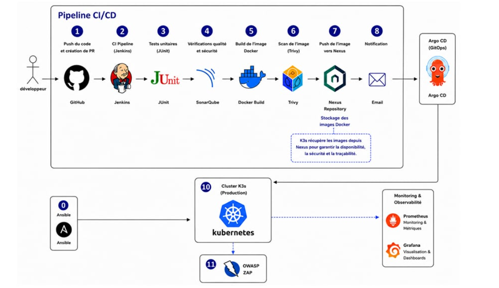

<div align="center">

# DevSecOps CI/CD Pipeline for Java Spring Boot

**Automate, secure, deploy, and monitor a Spring Boot application with a DevSecOps workflow.**

[](https://openjdk.org/)
[](https://spring.io/projects/spring-boot)
[](https://www.jenkins.io/)
[](https://www.docker.com/)
[](https://k3s.io/)
[](https://argo-cd.readthedocs.io/)
[](LICENSE)

</div>

## Overview

This project implements an end-to-end **DevSecOps CI/CD pipeline** for a Java Spring Boot application. It combines continuous integration, automated testing, code-quality analysis, container image scanning, image publication, GitOps-based deployment, dynamic application security testing, and monitoring.

The application source and CI/CD pipeline are maintained in this repository. Kubernetes deployment manifests are maintained separately in the [devsecops-gitops repository](https://github.com/YoussefJammoussi/devsecops-gitops).

## Architecture



The workflow connects the application source code to automated build and security checks, publishes the container image to Nexus Repository, and uses Argo CD to synchronize Kubernetes manifests from the GitOps repository to the K3s cluster. Ansible supports infrastructure/bootstrap automation, while Prometheus and Grafana provide monitoring and visualization.

## Workflow

1. **Source control** — application code and pipeline definition are versioned in GitHub.
2. **Continuous integration** — Jenkins checks out the source and orchestrates the pipeline.
3. **Build and tests** — Maven builds the Spring Boot application and JUnit runs unit tests.
4. **Coverage and code quality** — JaCoCo generates coverage reports and SonarQube analyzes code quality; the pipeline includes a Quality Gate stage.
5. **Container build** — Docker builds the application image.
6. **Image security scan** — Trivy scans the image for known vulnerabilities.
7. **Image publication** — the versioned image is pushed to Nexus Repository.
8. **GitOps deployment** — the deployment image reference is updated in the GitOps repository; Argo CD synchronizes the desired state to K3s.
9. **Dynamic security testing** — OWASP ZAP performs a scan against the deployed application.
10. **Monitoring and observability** — Prometheus collects metrics and Grafana presents dashboards.
11. **Automation support** — Ansible playbooks and `inventory.ini` support infrastructure/bootstrap tasks.

## Technology stack

| Tool | Role |
|---|---|
| GitHub | Source control and repository hosting |
| Jenkins | CI/CD pipeline orchestration |
| Java / Spring Boot | Application runtime and framework |
| Maven | Build and dependency management |
| JUnit | Automated unit tests |
| JaCoCo | Test coverage reporting |
| SonarQube | Static code analysis and Quality Gate |
| Docker | Container image build |
| Trivy | Container image vulnerability scanning |
| Nexus Repository | Container image registry |
| GitOps repository | Kubernetes deployment configuration |
| K3s / Kubernetes | Container orchestration |
| Argo CD | GitOps synchronization and deployment status |
| OWASP ZAP | Dynamic application security testing (DAST) |
| Prometheus | Metrics collection |
| Grafana | Dashboards and observability |
| Ansible | Infrastructure/bootstrap automation |

## Repository layout

```text
devsecops-cicd-pipeline-java-springboot/
├── ansible/
│   ├── inventory.ini
│   └── playbooks/
├── devsecops-app/
│   └── Dockerfile
├── docs/
│   ├── architecture.png
│   └── images/
│       ├── jenkins-pipeline.png
│       ├── sonarqube-quality-gate.png
│       ├── nexus-image.png
│       ├── argocd-healthy-synced.png
│       ├── application-running.png
│       ├── owasp-zap-report.png
│       └── grafana-kubernetes-dashboard.png
├── Jenkinsfile
├── LICENSE
└── README.md
```

The layout above documents the intended location for project documentation and screenshots. Keep the existing application files inside `devsecops-app/` and the Dockerfile in that directory. The GitOps manifests remain in the separate GitOps repository.

## Evidence and screenshots


| Screenshot | What it demonstrates |
|---|---|
| `jenkins-pipeline.png` | Jenkins pipeline execution and stage results |
| `sonarqube-quality-gate.png` | SonarQube analysis and Quality Gate |
| `nexus-image.png` | Published image in Nexus Repository |
| `argocd-healthy-synced.png` | Argo CD application synchronized and healthy |
| `application-running.png` | Deployed Spring Boot application responding successfully |
| `owasp-zap-report.png` | OWASP ZAP dynamic scan report |
| `grafana-kubernetes-dashboard.png` | Kubernetes metrics dashboard in Grafana |

## Security validation notes

The recorded OWASP ZAP scan of the tested application scope reported **0 High, 0 Medium, 0 Low, and 1 Informational alert**. The report also showed a high proportion of HTTP 4xx responses. These results describe that scan and its tested scope only; they do **not** prove that the application is completely secure.

An earlier Trivy scan identified High-severity findings related to Jackson dependencies. The dependency version was subsequently updated to `3.1.7`, and Jenkins build `#50` completed successfully, including the Trivy stage. A successful stage alone should not be interpreted as proof that the image has zero vulnerabilities; inspect the current scan output for the final finding count.

## Getting started

### Prerequisites

- Git
- Java version compatible with the application configuration
- Maven
- Docker
- Access to the Jenkins, SonarQube, and Nexus services used by the pipeline
- A Kubernetes/K3s cluster and Argo CD for deployment
- Access to the separate GitOps repository

### Clone the application repository

```bash
git clone https://github.com/YoussefJammoussi/devsecops-cicd-pipeline-java-springboot.git
cd devsecops-cicd-pipeline-java-springboot
```

### Build and test locally

Run the following commands from the directory containing the Maven `pom.xml` (expected to be `devsecops-app/`):

```bash
cd devsecops-app
mvn clean package
mvn test
```

The Jenkins pipeline is defined in the root `Jenkinsfile`. Configure the required tools and credentials in Jenkins before running it. Store credentials in Jenkins Credentials or an appropriate secret manager; **never commit passwords, access tokens, private keys, or registry credentials**.

## Related repository

- **Application and CI/CD:** [devsecops-cicd-pipeline-java-springboot](https://github.com/YoussefJammoussi/devsecops-cicd-pipeline-java-springboot)
- **Kubernetes manifests and GitOps configuration:** [devsecops-gitops](https://github.com/YoussefJammoussi/devsecops-gitops)

## Possible future improvements

- Add automated dependency scanning and software composition analysis.
- Define explicit vulnerability thresholds and document how the pipeline handles findings.
- Add automated deployment verification and rollback procedures.
- Add actionable Prometheus alerts and validate Alertmanager delivery.
- Document reproducible local setup and infrastructure requirements.

## Author

**Youssef Jammoussi**

DevSecOps project focused on CI/CD automation, security validation, GitOps deployment, and observability.

